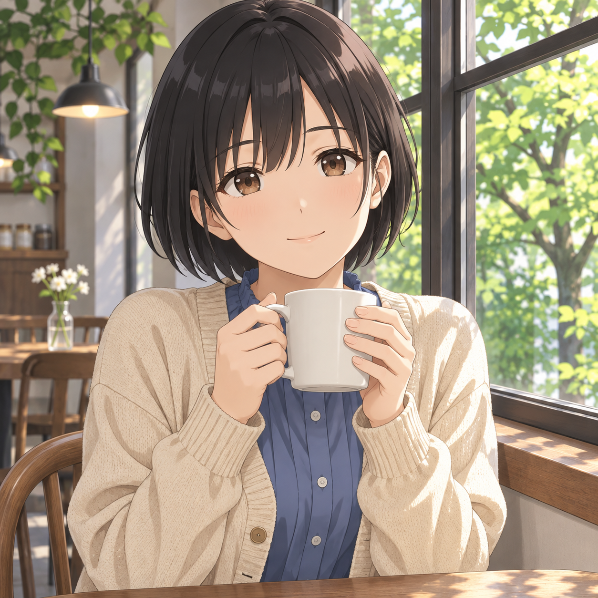
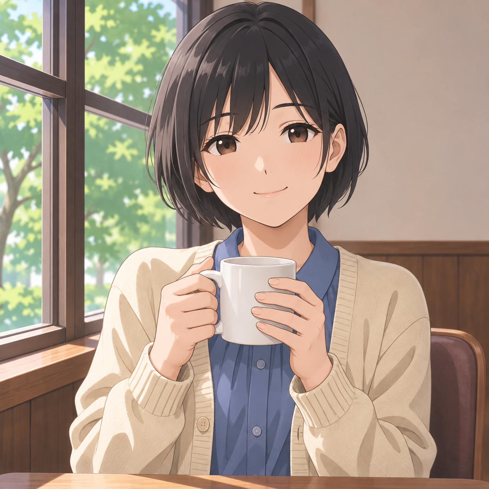
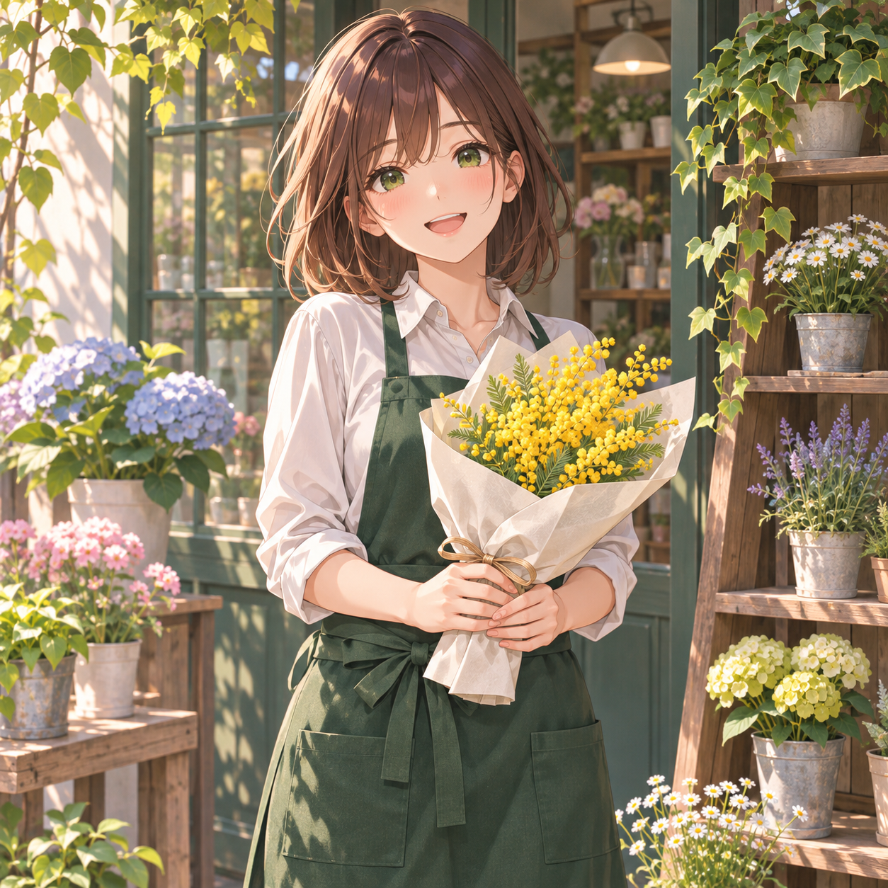
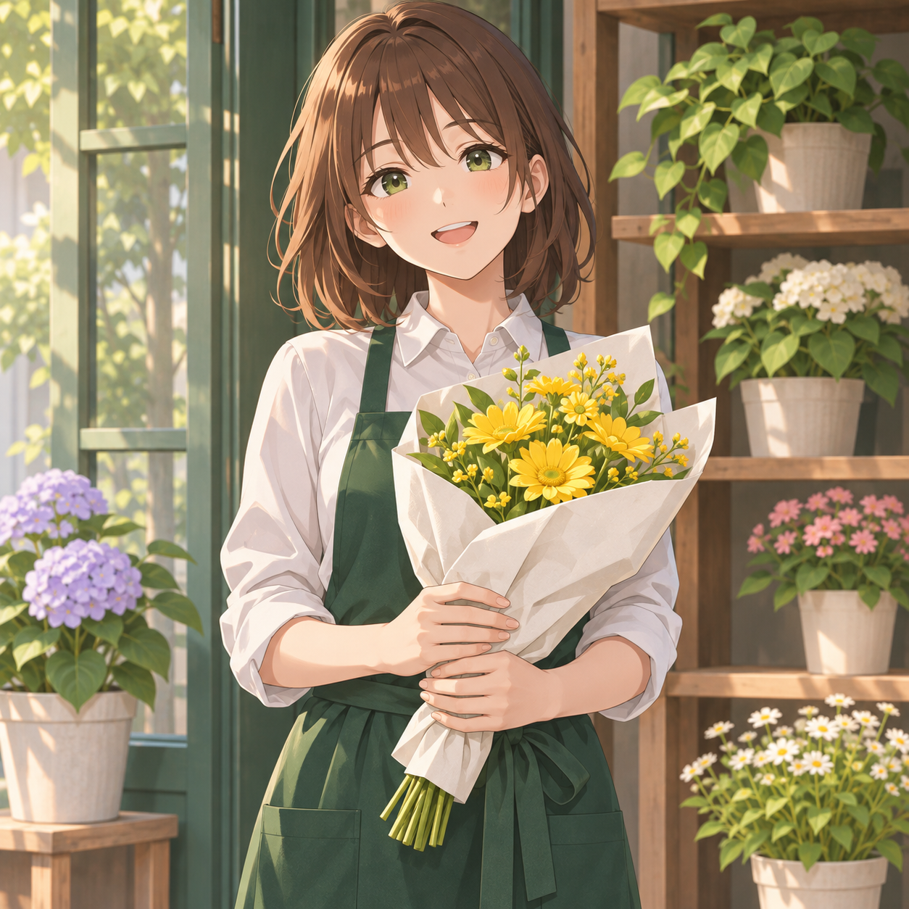
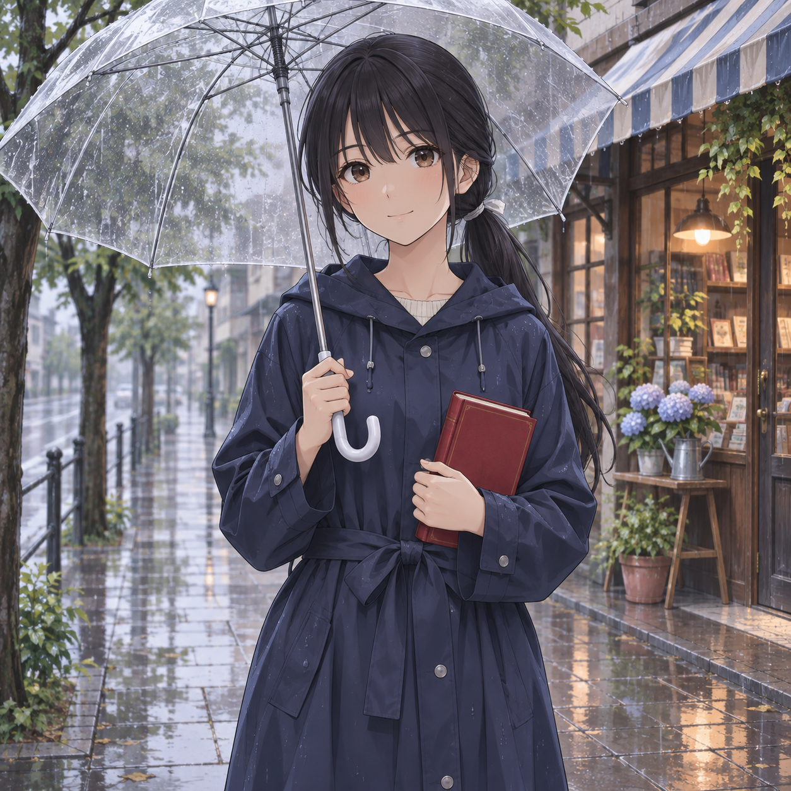
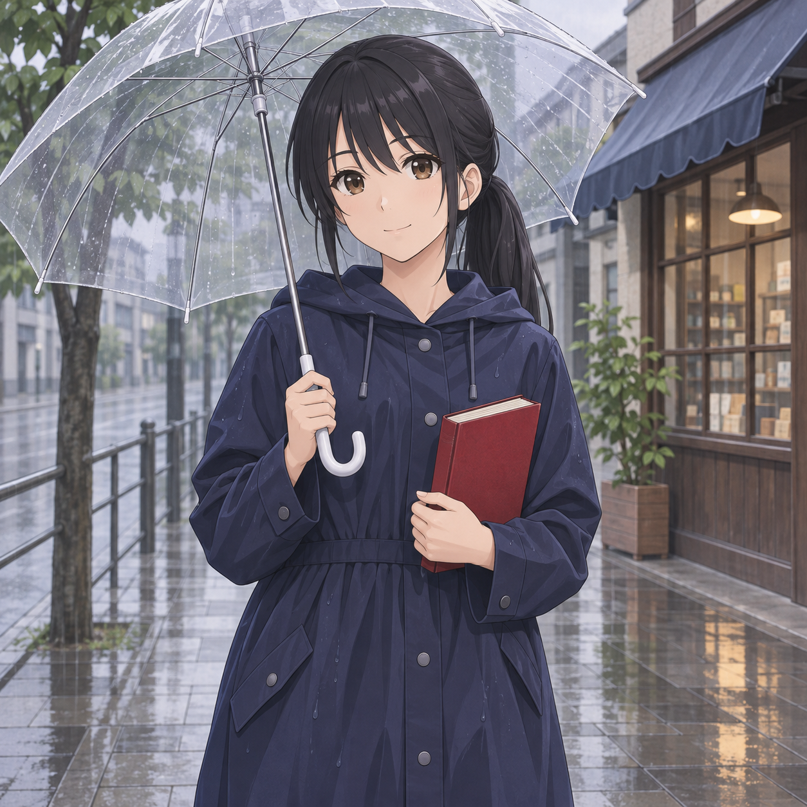
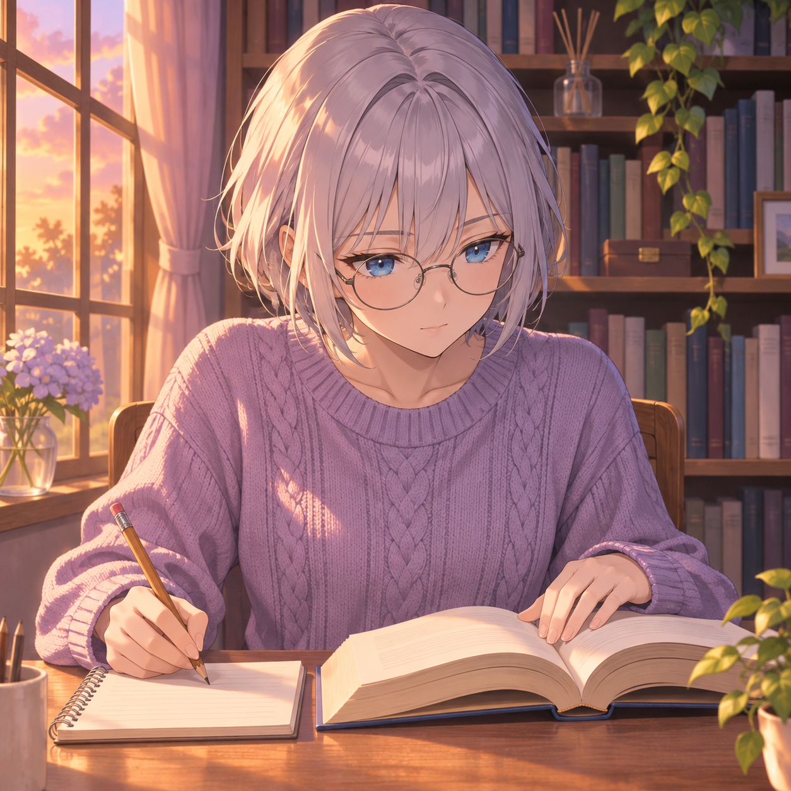
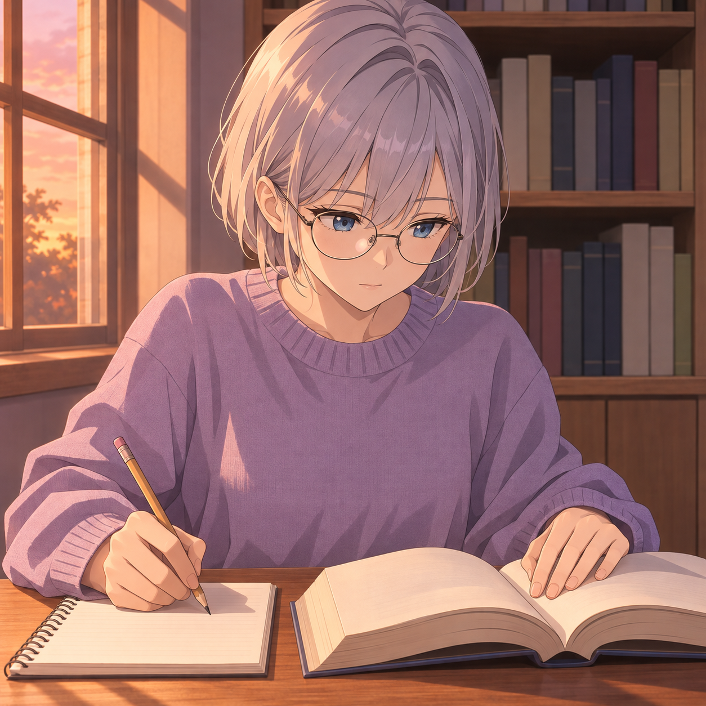

# Illustration Art Director

[](LICENSE)

イラストの造形・線・塗り・構図の違和感を具体的に見つけ、キャラクターや作品の魅力を保ちながら改善するためのAgent Skillです。

画像の診断、生成プロンプトの改善、局所編集、修正前後の比較に使います。画像生成モデルやAPIは同梱していません。画像生成・編集には、利用するエージェント側のツールが必要です。

## インストール

Codexで使うプロジェクトのルートから実行します。

```sh
git clone https://github.com/stockedge/illustration-art-director.git .agents/skills/illustration-art-director
```

このリポジトリのルートにある [SKILL.md](SKILL.md) がスキル本体です。比較画像が不要なら、`illustration-art-director` フォルダ内に `SKILL.md` だけを配置しても使えます。

## 使い方

画像を添付して、目的と守りたい特徴を指定します。

```text
$illustration-art-director このイラストの違和感を診断し、顔と衣装を維持したまま、重要な3点だけ修正して。
```

```text
$illustration-art-director この画像を監査して。編集せず、観察した問題と編集プロンプトを提示して。
```

元画像がない場合は、生成プロンプトを渡します。スキルは実画像を見たと仮定せず、描画方針を具体化します。

```text
$illustration-art-director 次の生成プロンプトを、人物・服装・構図を変えずに改善して：［元のプロンプト］
```

## スキル使用・不使用の比較サンプル

2026年11月12日、Codex上で2つのサブエージェントに同じお題を渡し、4組・計8枚を生成しました。すべてAI生成画像です。

- 不使用側は対象スキルを読まず、共通のお題をそのまま画像生成ツールに渡しました。
- 使用側は対象スキルを読み、共通のお題の指定を維持しながら、描画方針を最大3点追加しました。
- 両側とも標準の `imagegen` スキルとbuilt-in `image_gen` を使用しました。各お題につき1回ずつ生成し、選別・再生成・生成後の編集はしていません。
- 今回は元画像がないため、生成プロンプトを改善するモードの比較です。元画像の局所編集や、診断後に修正する手順全体の比較ではありません。
- シードを固定した比較ではありません。モデルのバージョンや内部設定も記録していないため、同一結果の再現やスキル単独の効果の検証はできません。

画像はクリックすると元のサイズで開けます。各組に、実際にツールへ渡したプロンプトを保存しています。

| お題 | スキル不使用 | スキル使用 |
| --- | --- | --- |
| カフェ | [](samples/01-cafe/without-skill.png) | [](samples/01-cafe/with-skill.png) |
| 花屋 | [](samples/02-flower-shop/without-skill.png) | [](samples/02-flower-shop/with-skill.png) |
| 雨の街角 | [](samples/03-rainy-street/without-skill.png) | [](samples/03-rainy-street/with-skill.png) |
| 読書と筆記 | [](samples/04-reading/without-skill.png) | [](samples/04-reading/with-skill.png) |

| お題 | 不使用側のプロンプト | 使用側のプロンプト |
| --- | --- | --- |
| カフェ | [全文](samples/01-cafe/without-skill-prompt.txt) | [全文](samples/01-cafe/with-skill-prompt.txt) |
| 花屋 | [全文](samples/02-flower-shop/without-skill-prompt.txt) | [全文](samples/02-flower-shop/with-skill-prompt.txt) |
| 雨の街角 | [全文](samples/03-rainy-street/without-skill-prompt.txt) | [全文](samples/03-rainy-street/with-skill-prompt.txt) |
| 読書と筆記 | [全文](samples/04-reading/without-skill-prompt.txt) | [全文](samples/04-reading/with-skill-prompt.txt) |

### 今回の画像で見られた違い

使用側は、カフェでは服の編み目、花屋や雨の街角では背景の小物、読書ではセーターの模様や背景の装飾が控えめになりました。人物や手元に注目しやすい一方、不使用側には細かな質感や背景を楽しめる魅力があります。顔立ちや全体の画風は、両側でよく似ています。

これは今回の画像を見た主観的な観察です。各お題で1枚ずつの比較なので、細部の減少をスキルの効果と断定したり、使用側が常に優れると結論づけたりはできません。特に、手や小物の形に一貫した改善があるかは確認できていません。

## 公開版の内容

提供された `SKILL.md` をもとに、同梱されていない参照資料・補助スクリプト・診断JSONサンプルへの案内を整理し、単体で読める公開版（1.0.1）にしました。診断の観点、保存対象の指定、局所編集、比較評価の手順は維持しています。比較画像は、この整理を行う前の1.0.0を使用して生成したものです。

## 限界

このスキルはAI生成かどうかを判定するものではありません。美しさや発光、彩度を一律に問題とせず、作品の意図に照らして評価します。AI使用履歴の改ざん、透かしや来歴情報の除去、作者の偽装を目的としません。

スキル単独では画像を生成・編集できません。画像編集ツールがない環境では、診断と具体的な編集プロンプトまでを返します。

## License

[MIT License](LICENSE) — Copyright (c) 2026 stockedge.
